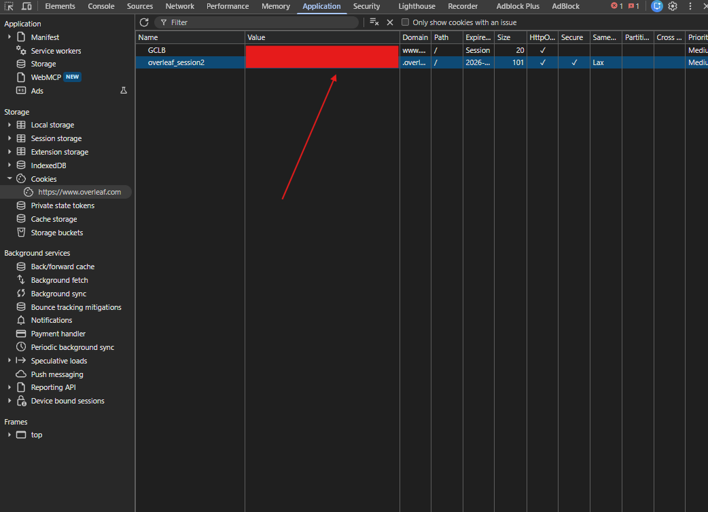

# Overleaf helper

Work on Overleaf projects from Claude Code: pull a project into a local git working copy, push local
edits back, see what changed, and read the edit history, comments, suggestions and chat of all
coauthors together with the text they refer to. Packaged as the Claude skill `overleaf-helper`.

## Install

In Claude Code:

```
/plugin marketplace add Qq1b3/overleaf-helper
/plugin install overleaf-helper@overleaf-helper
```

It needs Python 3.9 or newer with `pip install requests keyring`, and git 2.28 or newer. Other ways
to install: [claude-skill/README.md](claude-skill/README.md).

## Log in once

1. Log in to Overleaf in Chrome; organisation login works.
2. Press F12, open Application, Cookies, `https://www.overleaf.com`, and copy the Value of
   `overleaf_session2`:

   

3. Tell Claude "copied", or run
   `python claude-skill/skills/overleaf-helper/scripts/overleaf.py login` and paste the value at
   the hidden prompt.

The cookie goes into the system credential store. Never paste it into a chat.

## Use

Ask Claude, for example:

- "Clone our Overleaf paper https://www.overleaf.com/project/... and list the open comments."
- "What did my coauthors change and discuss since Monday?"
- "Fix the typos in the introduction and push them as suggestions."
- "Accept Anna's suggestions in intro.tex."
- "Comment that the abstract is too long, and suggest a shorter first sentence."
- "Export all comments with the text they refer to as JSON."
- "Upload my paper in ~/papers/icra to Overleaf as a new project."
- "Give me the edit link of our Overleaf paper."

Claude shows everything it would write to Overleaf, such as a push, a comment or a suggestion, as a
dry run first and sends it only after your OK. The commands it uses, which also work in a terminal
(`overleaf.py --help`):

| Command | What it does |
|---|---|
| `projects`, `create`, `clone`, `pull`, `push` | list projects, create a project, make a working copy, bring changes in, send edits |
| `status`, `diff` | what changed locally, on Overleaf, or between history versions |
| `history`, `timeline` | who changed what when; every event of all coauthors in time order |
| `comments`, `changes`, `accept` | comments with the text they refer to; suggestions waiting for review; accept them |
| `comment`, `reply`, `resolve`, `suggest` | comment on text, answer or resolve comments; suggest a change for review |
| `compile`, `replay` | the build on Overleaf; the history as git commits for `git blame` |
| `share` | the edit and view links of link sharing; turn it on or off |

The skill and its code are in [claude-skill/](claude-skill/), with more on installing and logging in
in [claude-skill/README.md](claude-skill/README.md).
