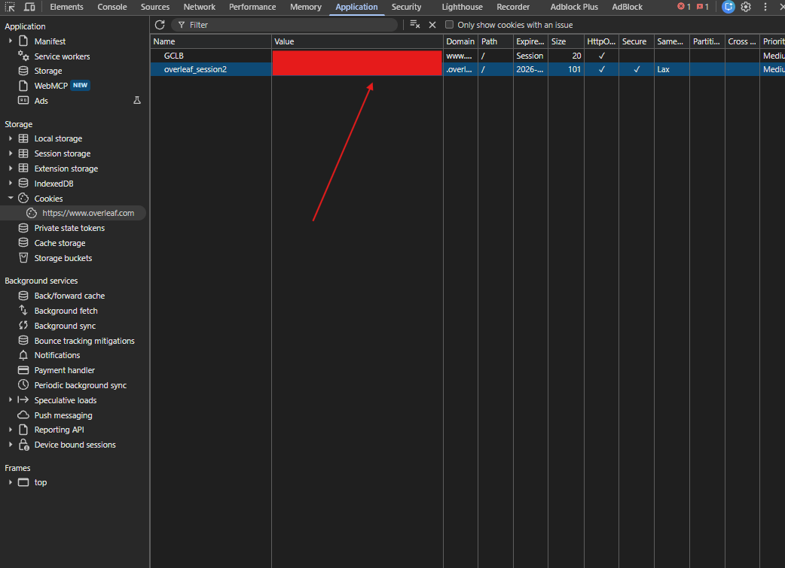

# Claude skill: Overleaf helper

A skill for Claude Code that works on Overleaf projects from a local folder. It pulls a project into
a git working copy and pushes local edits back, as plain edits or as tracked changes for coauthors
to review. It shows what changed locally, on Overleaf or between history versions, and reads the
edit history, comments, suggestions and chat of all coauthors together with the text they refer to.
It also compiles on Overleaf and shows who wrote which line.

Example requests once installed:

- "Clone our Overleaf paper https://www.overleaf.com/project/... and list the open comments."
- "What did my coauthors change and discuss since Monday?"
- "Fix the typos in the introduction and push them as suggestions."
- "Export all comments with the text they refer to as JSON."
- "Upload my paper in ~/papers/icra to Overleaf as a new project."
- "Does the project still compile on Overleaf?"

Claude picks the skill up from requests like these. It can also be called directly with
`/overleaf-helper` (or `/overleaf-helper:overleaf-helper` when installed as a plugin).

## Requirements

- Claude Code (terminal, VS Code or desktop app). The Claude app cannot reach Overleaf with your
  session.
- Python 3.9 or newer with `requests` and `keyring`: `pip install requests keyring`
- git 2.28 or newer
- An Overleaf account; organisation login works, no password is needed

## Install

### Option A: Claude Code plugin (recommended, gets updates)

In Claude Code:

```
/plugin marketplace add Qq1b3/overleaf-helper
/plugin install overleaf-helper@overleaf-helper
```

Updates: `/plugin marketplace update overleaf-helper`, or turn on auto-update for the `overleaf-helper`
marketplace in `/plugin`.

### Option B: copy the folder

Copy `claude-skill/skills/overleaf-helper/` to

- `~/.claude/skills/overleaf-helper/` for all projects of one user
  (Windows: `%USERPROFILE%\.claude\skills\overleaf-helper\`), or
- `<project>/.claude/skills/overleaf-helper/` for one project.

Updates: copy the folder again.

## Log in once

The tool uses the session of your Overleaf login in Chrome, so organisation login works.

1. Log in to Overleaf in Chrome.
2. Press F12, open Application, Cookies, `https://www.overleaf.com`, and copy the Value of
   `overleaf_session2`:

   

3. Tell Claude "copied". Claude runs `login --clipboard`, which reads the cookie from the clipboard,
   clears the clipboard and checks the cookie with Overleaf. Without Claude, run
   `python <skill folder>/scripts/overleaf.py login` and paste the value at the hidden prompt.

The cookie is kept in the system credential store (on Windows the Credential Manager), never in a
project folder. Never paste it into a chat: it gives full access to your Overleaf account. When it
expires, or after you log out of Overleaf in Chrome, copy it again.

## How it works

- `clone` makes a git working copy of a project: the branch `overleaf` holds the snapshots of
  Overleaf, `main` your edits. `pull` brings the changes on Overleaf and merges them into `main`.
- `push` first shows a dry run with the steps and the full diff, and writes only with `--yes`;
  Claude asks you before. Text files get word-level edits, like typing in the editor, so comments
  stay on their words.
- `timeline`, `history`, `comments` and `changes` show what all coauthors did, as text, Markdown or
  JSON. Comments are read-only.
- Overleaf has no public API, so the tool uses the calls of the Overleaf editor. When Overleaf
  changes one, a command stops with the name of that call.

## What is inside

```
claude-skill/
  .claude-plugin/plugin.json
  README.md                          this file
  images/overleaf-cookie.png         where to copy the cookie
  skills/overleaf-helper/
    SKILL.md                         instructions Claude follows
    reference/export-format.md       fields of the JSON and the inline copies
    scripts/overleaf.py              the command line; run it with --help
    scripts/ol_auth.py               login, cookie storage
    scripts/ol_api.py                all calls to Overleaf
    scripts/ol_create.py             create a project on Overleaf, also from a local folder
    scripts/ol_sync.py               git working copy: clone, pull, status, diff
    scripts/ol_push.py               push
    scripts/ol_review.py             history, timeline, comments, suggestions, replay
    scripts/ol_compile.py            compile on Overleaf, log summary
```
